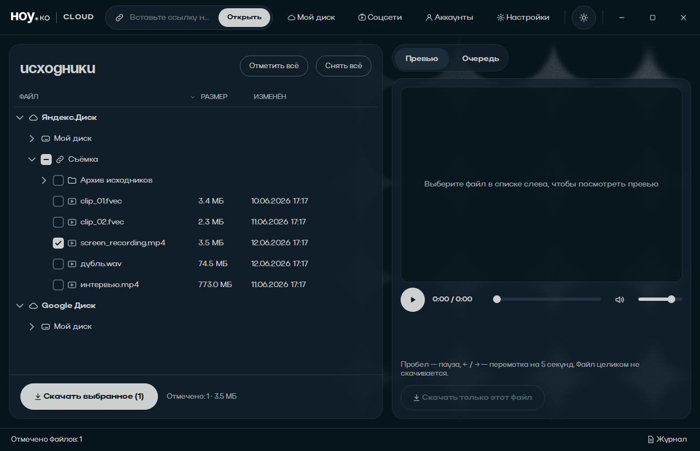

# svsCloud

Настольная утилита для монтажёров: открыть папку на **Яндекс.Диске** или
**Google Диске** (свою или по публичной ссылке), посмотреть превью,
отметить нужные файлы и скачать их с докачкой.

 
[](https://github.com/peeppohui/svsCloud/releases/latest/download/svsCloud-win64.zip)

## 📥 Скачать

### Инструкция для монтажёра

Как установить и пользоваться — по шагам, без технических деталей.
Та же инструкция лежит в [`docs/ИНСТРУКЦИЯ.md`](docs/ИНСТРУКЦИЯ.md)
и попадает в папку `docs` рядом с программой.

#### 1. Что это

svsCloud — программа для Windows, которая открывает папку на **Яндекс.Диске** или **Google Диске** по ссылке, показывает превью видео прямо в окне и скачивает нужные файлы с докачкой.

Главное: **вход в аккаунт не нужен**. Есть публичная ссылка — вставили её и работаете. Войти в свой диск нужно только тогда, когда вы хотите заглянуть в свои личные файлы.

#### 2. Установка

**Что нужно:** Windows 10 или 11, 64 бит. Python устанавливать **не нужно**.

1. Скачайте архив (кнопка ниже) — около 134 МБ.
2. Распакуйте архив в отдельную папку, например `D:\svsCloud`. **Не запускайте программу прямо из архива** — сначала распакуйте. Внутри архива:
   ```
   svsCloud.exe      ← сама программа
   _internal\        ← её библиотеки, не трогайте
   bin\              ← ffmpeg для редких форматов
   docs\             ← эта инструкция и документация
   ```
3. Запустите `svsCloud.exe` двойным кликом.

**Если Windows показывает «Windows защитил ваш компьютер»** — это потому, что программа не подписана сертификатом. Нажмите **«Подробнее» → «Выполнить в любом случае»**. Это нормально для бесплатных программ.

**Совет:** положите папку с программой на диск, где много свободного места (например, `D:\svsCloud`), и не засовывайте её в `C:\Windows` или на сетевой диск.

#### 3. Что вы видите при первом запуске

```
┌────────────────────────────────────────────────────────────┐
│ Аккаунты │ Открыть ссылку │ Мой диск │            Настройки│  ← панель сверху
├──────────────────────┬─────────────────────────────────────┤
│ Файлы                │  [ Превью ]  [ Очередь ]           │
│                      │                                     │
│ ▾ Яндекс.Диск        │                                     │
│   ▸ Мой диск         │                                     │
│   ▸ открытая ссылка  │                                     │
│ ▾ Google Диск        │                                     │
│   ▸ Мой диск         │                                     │
│                      │                                     │
│ [Отметить всё] [Снять всё]                                │
│ [ Скачать выбранное ]  Отмечено: 0                        │
├──────────────────────┴─────────────────────────────────────┤
│ Готово                                            Журнал   │  ← строка статуса
└────────────────────────────────────────────────────────────┘
```

Слева — дерево файлов, справа — вкладки «Превью» и «Очередь».

#### 4. Главный сценарий: скачать папку по ссылке

1. Нажмите **«Открыть ссылку»** (или `Ctrl+O`).
2. Вставьте ссылку из Яндекс.Диска или Google Диска и нажмите Enter.
   - Яндекс: `https://disk.yandex.ru/d/XXXXXXX` или `https://disk.yandex.ru/i/XXXXXXX`
   - Google: `https://drive.google.com/drive/folders/XXXXXXX` или `.../file/d/XXXXXXX`
3. Слева появится дерево файлов. **Папки подгружаются по мере раскрытия** — раскройте нужную.
4. Поставьте галочки на нужных файлах. Галочка на папке отмечает всё внутри неё.
   - Рядом с кнопкой показывается, сколько файлов отмечено и их общий объём.
5. Нажмите **«Скачать выбранное (N)»**. Программа переключится на вкладку **«Очередь»** и начнёт качать.

**Куда качается:** по умолчанию в `C:\Users\<Ваше имя>\Downloads\svsCloud`. Папка загрузки меняется в «Настройках».

**Структура папок сохраняется** — если в облаке было `Съёмка/День 1/clip.mov`, на диске получится `Downloads\svsCloud\Съёмка\День 1\clip.mov`. Файлы с одинаковым именем из разных папок не путаются.

#### 5. Превью

Выберите файл в дереве — программа сама покажет его на вкладке «Превью». Можно и **двойным кликом** или **Enter** (тогда вкладка переключится сама).

- **Пробел** — пауза / продолжить
- **← →** — перемотка на 5 секунд
- Есть звук, громкость и кнопка mute.

**Файл целиком не скачивается** — плеер тянет из облака только нужные куски. Тяжёлое видео (4K, 100 Мбит/с) на обычном интернете не дёргается, а честно буферизуется: показывается процент и «ещё ~0:25», когда запаса хватает — ровные 25 кадров/с. Если ждать не хочется — появится кнопка «Смотреть сразу».

**Что открывается:** видео mp4, mov, mkv, avi, mts, mxf, dv, 3gp (H.264, HEVC, ProRes, DNxHD); звук mp3, wav, m4a, flac; фотографии jpg, png, tif, jp2, svg и другие.

**Что не открывается:** RAW-фото (CR2, NEF, ARW) и HEIC — их нужно скачивать. Если формат не открылся, программа сама сделает облегчённую копию через ffmpeg, но показывает только первую минуту.

Повторный просмотр того же файла идёт из кэша и почти не тратит интернет.

#### 6. Свой «Мой диск» (вход в аккаунт)

Нужен, чтобы открыть личные файлы, а не только те, что по ссылке.

1. **«Настройки»** → раздел «Доступ к облакам» → впишите ключи приложения:
   - Яндекс.Диск — Client ID и Client Secret
   - Google Диск — Client ID, Client Secret и API Key
   - Google API Key нужен для публичных папок **без входа**.

   > Обычно эти ключи уже вписаны в вашу сборку — тогда ничего заполнять не нужно.

2. **«Аккаунты»** → **«Войти через Яндекс.Диск»**:
   - откроется браузер со страницей Яндекса, там нужно нажать «Разрешить»;
   - Яндекс покажет **код подтверждения** (буквы и цифры). Программа возьмёт его из буфера обмена сама — просто скопируйте код (`Ctrl+C`) и вставьте в поле, нажмите Enter.
3. **«Войти через Google Диск»**: откроется браузер, вход идёт через Google, потом вы вернётесь в программу сами. Галочку доступа к Google Диску оставьте включённой.
4. После входа нажмите **«Мой диск»** → выберите нужное облако.

**Выйти** из аккаунта в программе нельзя (кнопки нет). Если нужно выйти — закройте программу и удалите файл `%APPDATA%\svsCloud\tokens.dat`, либо запустите в командной строке:
```
"C:\путь\к\svsCloud.exe" --reset-tokens
```

#### 7. Настройки

**«Настройки»** (кнопка справа на панели сверху):

| Раздел | Что настроить | Рекомендация |
|---|---|---|
| Доступ к облакам | ключи Яндекса и Google | вписано в сборке — не трогайте |
| Загрузки | **Папка загрузок** | поставьте на диск с большим объёмом |
| | Файлов одновременно | 4 (по умолчанию) — быстрее при интернете от 100 Мбит/с |
| | Частей одного файла | 4 — один большой файл качается быстрее |
| | Размер части от | 64 МБ |
| | Докачивать большие файлы по частям | включено |
| | Ограничение скорости | см. предупреждение ниже |
| Превью | Путь к ffmpeg | пусто — программа найдёт сама |
| | Папка кэша превью | по умолчанию в папке загрузок; на быстрый диск, если он отличается |
| | Предел кэша | 4 ГБ — старое удаляется автоматически |
| | Занято / Открыть папку / Очистить кэш | «Очистить кэш» удаляет только куски превью, скачанные файлы не трогает |

> ⚠️ **Ограничение скорости:** в текущей версии не выставляйте значение от 1 до 4 Мбит/с — загрузка на этом значении встаёт (известная ошибка, будет исправлена). Поставьте 0 («Без ограничения») либо 5 и выше.

#### 8. Очередь загрузок

Вкладка **«Очередь»**: таблица с колонками «Файл | Размер | Прогресс | Скорость | Состояние».

- Выделите строку или несколько (Ctrl+клик, Shift+клик) и нажмите **«Пауза»**, **«Продолжить»**, **«Отменить»** или **«Убрать из списка»**.
- **«Отменить»** удаляет недокачанный кусок. **«Убрать из списка»** — только из таблицы.
- **«Открыть папку»** — открыть папку загрузок в проводнике.
- Уже скачанный файл того же размера повторно не качается. Если файл с тем же именем, но другим размером уже есть, новый сохранится рядом как `имя (1).расширение`.

**Докачка.** Если связь оборвалась, программа сама переподключится и продолжит с места обрыва. Если программа была закрыта или упала — при следующем запуске незаконченные загрузки подхватятся автоматически, ничего нажимать не нужно.

#### 9. Горячие клавиши

| Клавиши | Действие |
|---|---|
| `Ctrl+O` | открыть ссылку |
| `Ctrl+D` | скачать отмеченное |
| `Enter` | открыть превью выбранного файла |
| `Пробел` | пауза / продолжить в плеере |
| `←` `→` | перемотка на 5 секунд |
| `Delete` | убрать открытую ссылку из дерева |

#### 10. Обновление программы

Скачайте новый архив и **распакуйте поверх старой папки** — настройки, вход в аккаунты и история загрузок сохранятся (они лежат не рядом с программой, а в `%APPDATA%`).

Если распаковываете в другую папку — ничего не потеряется, но программа «забудет» папку кэша превью (настройки при этом останутся).

#### 11. Где что лежит на компьютере

| Что | Где |
|---|---|
| Настройки | `%APPDATA%\svsCloud\config.json` |
| Входы в аккаунты | `%APPDATA%\svsCloud\tokens.dat` (зашифровано) |
| Журнал работы | `%APPDATA%\svsCloud\logs\svscloud.log` |
| Кэш превью | `<папка загрузок>\.svscloud-preview` |

Журнал открывается прямо из программы: ссылка **«Журнал»** в правом нижнем углу. Если что-то пошло не так — пришлите этот файл, в нём видно, на каком шаге была ошибка.

#### 12. Если что-то не работает

**Ссылка не открывается, ошибка 404**
Убедитесь, что ссылка именно на **общий доступ** («Все, у кого есть ссылка»). Если доступ выдан лично вам — по ссылке из инкогнито она не откроется, нужен вход в аккаунт.

**«Файл не скачан: превышен лимит запросов»**
Яндекс ограничил полосу для публичной ссылки. Подождите и нажмите «Продолжить» в очереди.

**Google: публичная папка не открывается**
Нужен Google API Key в «Настройках» (или вход в аккаунт). Без ключа Google отдаёт отказ.

**Загрузка стоит и ничего не происходит**
Проверьте «Ограничение скорости» — значение от 1 до 4 Мбит/с в этой версии не работает.

**Превью не открывается**
Посмотрите вкладку «Превью» — программа напишет, что формат не поддерживается. Качайте файл и открывайте в привычном редакторе.

**Файл скачался, но не воспроизводится**
Скорее всего, это RAW или HEIC — они не воспроизводятся штатными средствами Windows.

**Программа не запускается**
Скачайте архив заново и распакуйте полностью (в архиве 130 файлов). Скопируйте текст ошибки из чёрного окна, если оно появится.

#### 13. Ограничения

- Один аккаунт каждого облака на одном компьютере. За несколькими аккаунтами — через разные профили Windows.
- Программа только читает облако: загрузить, переименовать или удалить файлы в облаке из неё нельзя.
- Google Документы скачиваются только через экспорт (PDF/XLSX) и не больше ~10 МБ.
- Публичные ссылки Яндекса ограничены по скорости самим Яндексом — это не ограничение программы.

---

**[⬇ Скачать svsCloud для Windows](https://github.com/peeppohui/svsCloud/releases/latest/download/svsCloud-win64.zip)** — 134 МБ

Распакуйте архив и запустите `svsCloud.exe`. Python устанавливать не нужно.

Чтобы забрать папку по публичной ссылке, **вход не требуется**: вставьте
ссылку в поле «Открыть ссылку», отметьте нужные файлы и нажмите
«Скачать выбранное».



## Возможности

* Вход через OAuth 2.0 в Яндекс.Диск и Google Диск; публичные ссылки — **без входа**.
* Дерево файлов с чекбоксами, ленивая подгрузка папок, «отметить всё».
* Превью видео/аудио/изображений прямо в программе — потоковое, с перемоткой,
  файл целиком не скачивается. Открываются исходники с камер: H.264, HEVC,
  ProRes, DNxHD в mp4, mov, mkv, avi, mts, mxf; звук mp3, wav, m4a, flac.
  Достаточно выбрать файл в списке (двойной клик или Enter — открыть вкладку
  «Превью»); пробел — пауза, ←/→ — перемотка на 5 секунд.
  Тяжёлые файлы (4K 100 Мбит/с при обычном интернете) не дёргаются, а честно
  буферизуются с процентом и временем ожидания; повторный просмотр — из кэша.
* Очередь загрузок: 4 файла параллельно, каждый до 4 частей, докачка с
  места обрыва, продолжение после перезапуска программы.
* Понятные сообщения вместо стектрейсов: «Файл не скачан: превышен лимит запросов».

## Быстрый старт (для разработки)

```powershell
python -m pip install -r requirements.txt
python run.py
```

## Сборка .exe для монтажёров

```powershell
powershell packaging\build.ps1
```

Готовый файл: `dist\svsCloud\svsCloud.exe`. ffmpeg для превью не нужен — плеер
уже содержит FFmpeg. `bin\ffmpeg.exe` (см. `tools\fetch_ffmpeg.py`) — только
запасной путь для редких форматов, которые плеер не открыл.

Сборку можно сразу настроить на свои ключи OAuth — тогда монтажёрам не нужно
ничего вводить, достаточно нажать «Аккаунты» → «Войти»:

```powershell
powershell packaging\build.ps1 `
    -YandexClientId "1234567890" -YandexClientSecret "секрет" `
    -GoogleClientId "xxxx.apps.googleusercontent.com" -GoogleClientSecret "GOCSPX-..."
```

## Документация

| Документ | О чём |
|---|---|
| [docs/ИНСТРУКЦИЯ.md](docs/ИНСТРУКЦИЯ.md) | Инструкция для монтажёра: установка, скачивание по ссылке, превью, настройки |
| [docs/ARCHITECTURE.md](docs/ARCHITECTURE.md) | Стек и обоснование, компоненты, алгоритмы, этапы внедрения, подводные камни API |
| [docs/OAUTH_SETUP.md](docs/OAUTH_SETUP.md) | Как получить Client ID/Secret у Яндекса и Google, как раздать ключи монтажёрам |

## Первый запуск

1. «Открыть ссылку» → вставьте ссылку на папку — **работает сразу, без входа**.
2. Отметьте нужные файлы → «Скачать выбранное».

Чтобы заглядывать в свой «Мой диск», нажмите «Аккаунты» и войдите —
тогда понадобятся ключи приложения (см. [docs/OAUTH_SETUP.md](docs/OAUTH_SETUP.md)).

## Тесты

```powershell
python -m unittest discover -s tests -t .
```

Покрыты: планирование сегментов, backoff, разбор ссылок, разбор ответов API,
человеческие формулировки ошибок, скачивание с обрывом связи и докачкой,
Range-прокси превью, плеер превью (звук, перемотка, картинки, ошибки),
дерево файлов с чекбоксами (headless, Qt offscreen).

## Где что лежит

```
app/core/        модели, настройки, ошибки, шины, фоновый event loop
app/net/         HTTP-клиент, лимиты запросов, backoff, кэш в SQLite
app/oauth/       Яндекс и Google: вход, обновление токена, loopback-сервер
app/providers/   список файлов, ссылки на скачивание, разбор URL
app/downloader/  очередь, сегменты, докачка, состояние на диске
app/preview/     локальный Range-прокси, плеер на QtMultimedia (FFmpeg), ffmpeg-фолбэк
app/ui/          окно, дерево, очередь, диалоги, тема
docs/            архитектура и инструкция по OAuth
packaging/       сборка .exe
tools/           загрузка ffmpeg
tests/           автотесты (stdlib unittest)
```

## Ограничения

* Один аккаунт каждого облака на одной машине (несколько — через разные профили Windows).
* Google Документы скачиваются только через экспорт (PDF/XLSX) и с ограничением ~10 МБ.
* Публичные ссылки Яндекса ограничены по полосе — это ограничение Яндекса, а не программы.
