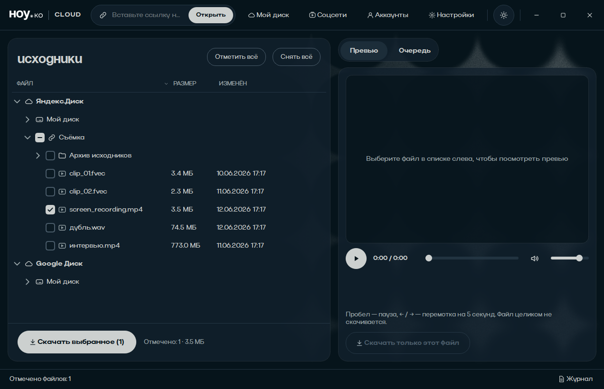

# НоуКо Cloud

Настольная утилита для монтажёров: открыть папку на **Яндекс.Диске** или
**Google Диске** (свою или по публичной ссылке), посмотреть превью,
отметить нужные файлы и скачать их с докачкой.

 
[](https://github.com/peeppohui/NouKoCloud/releases/latest/download/NoukoCloud-win64.zip)

## 📥 Скачать

**[📖 Инструкция для монтажёра](docs/ИНСТРУКЦИЯ.md)** — установка, первый
запуск, скачивание по ссылке, превью, настройки, очередь, решение проблем.

**[⬇ Скачать НоуКо Cloud для Windows](https://github.com/peeppohui/NouKoCloud/releases/latest)** — установщик `NoukoCloud-Setup-*.exe` (ставится без прав администратора, ярлык в «Пуск») или portable-архив (~110 МБ), который распаковывается в любую папку и запускается без установки.

> Сборка не подписана сертификатом: Windows покажет «Неизвестный издатель» — нажмите «Подробнее» → «Выполнить в любом случае».

При первом запуске программа показывает **мастер настройки**: ключи доступа
к облаку, папка загрузок, автозапуск и сворачивание в трей. Пропустить можно —
публичные ссылки работают и без ключей.



## Для разработчика

### Быстрый старт

```powershell
python -m pip install -r requirements.txt
python run.py
```

### Сборка .exe

```powershell
powershell packaging\build.ps1
```

Готовый файл: `dist\NoukoCloud\NoukoCloud.exe`. ffmpeg для превью не нужен —
плеер уже содержит FFmpeg. `bin\ffmpeg.exe` (см. `tools\fetch_ffmpeg.py`) —
только запасной путь для редких форматов и для сохранения кадра в PNG.

**Осторожно с ключами OAuth.** Если в сборку вставить настоящие ключи, они
попадут в публичный архив — их сможет забрать кто угодно. По умолчанию
публичный релиз собирается **без** ключей (`-NoPortableKeys`), пользователь
вводит их в мастере настройки или в «Настройках». Для своей приватной раздачи:

```powershell
powershell packaging\build.ps1 `
    -YandexClientId "1234567890" -YandexClientSecret "секрет" `
    -GoogleClientId "xxxx.apps.googleusercontent.com" -GoogleClientSecret "GOCSPX-..."
```

### Релиз

```powershell
powershell packaging\release.ps1 -Version 1.1.0
```

Скрипт собирает portable-архив, проверяет, что внутри нет настоящих ключей,
считает SHA256, пишет `latest.json` и публикует всё на GitHub Releases.
Подробности — [docs/RELEASING.md](docs/RELEASING.md).

### Тесты

```powershell
python -m unittest discover -s tests -t .
```

Покрыты: планирование сегментов, backoff, разбор ссылок, разбор ответов API,
человеческие формулировки ошибок, скачивание с обрывом связи и докачкой,
Range-прокси превью, плеер превью (звук, перемотка, кадры, in/out, ошибки),
дерево файлов с чекбоксами и поиском, мастер первого запуска, кэш метаданных
и миграции настроек (headless, Qt offscreen).

## Документация

| Документ | О чём |
|---|---|
| [docs/ИНСТРУКЦИЯ.md](docs/ИНСТРУКЦИЯ.md) | Инструкция для монтажёра: установка, первый запуск, скачивание, превью, поиск, очередь, настройки, решение проблем |
| [docs/ПОДКЛЮЧЕНИЕ_АККАУНТОВ.md](docs/ПОДКЛЮЧЕНИЕ_АККАУНТОВ.md) | Как получить Client ID/Secret у Яндекса и Google, как войти, выйти и сменить аккаунт |
| [docs/ARCHITECTURE.md](docs/ARCHITECTURE.md) | Стек и обоснование, компоненты, алгоритмы, кэш и миграции, этапы внедрения, подводные камни API |
| [docs/RELEASING.md](docs/RELEASING.md) | Как собрать и опубликовать релиз, подпись, установщик, SHA256 и latest.json |
| [docs/OAUTH_SETUP.md](docs/OAUTH_SETUP.md) | Как получить ключи и раздать их монтажёрам |
| [THIRD_PARTY_NOTICES.md](THIRD_PARTY_NOTICES.md) | Сторонние компоненты и их лицензии |
| [LICENSE](LICENSE) | Лицензия самой программы |

## Где что лежит

```
app/core/        модели, настройки, ошибки, шины, фоновой event loop, диагностика
app/net/         HTTP-клиент, лимиты запросов, backoff, кэш листингов в SQLite
app/oauth/       Яндекс и Google: вход, обновление токена, loopback-сервер
app/providers/   список файлов, ссылки на скачивание, разбор URL
app/downloader/  очередь, сегменты, докачка, состояние на диске, отчёт CSV
app/preview/     локальный Range-прокси, плеер на QtMultimedia, ffmpeg-фолбэк
app/ui/          окно, дерево, очередь, диалоги, мастер настройки, тема
docs/            инструкции и архитектура
packaging/       сборка .exe и сценарий релиза
tools/           ffmpeg, манифест релиза, публикация на GitHub
tests/           автотесты (stdlib unittest)
```
